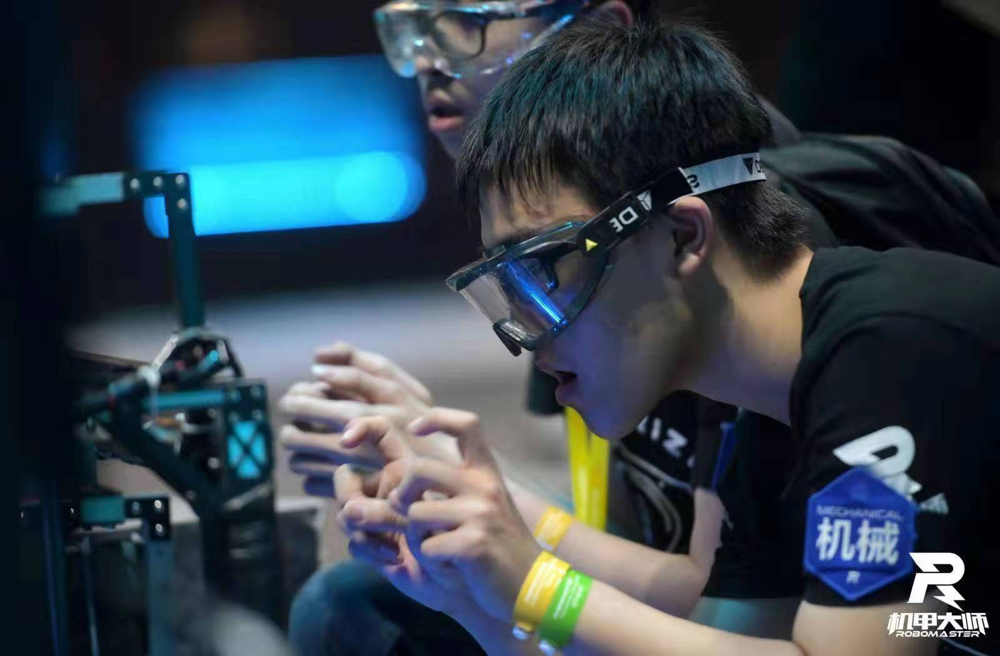

I attended RoboMaster Competition representing the [HKUST RoboMaster Team (ENTERPRIZE)](https://www.robomasterhkust.com/). I was a mechanical team member in 2019 and I was captain in 2020. The team won Grand Prize in International Regional and First Prize in Final Tournament.

# **My responsibility**
**RoboMaster 2019** **As Mechanical Engineer:**
Engineering Robot (升降腿) chassis modeling, building and maintenance. Development of integrated stair climbing mechanism with suspension system.

**RoboMaster 2020** **As Captain & Mechanical Engineer:**
Double shooter Infantry robot double shooter modeling, building and maintenance. Help with Dart robot development. Project management, promotion, manpower management......

# **About the Competition**

[RoboMaster (机甲大师)](https://www.robomaster.com/en-US) is an annual intercollegiate robot competition held in Shenzhen, Guangdong, China, founded and hosted by the drone tech giant DJI. First started in 2015, it is the brainchild of DJI's founder and CEO Frank Wang, and jointly sponsored by the Communist Youth League Central Committee, the All-China Students' Federation (ACSF) and the Shenzhen City Government.[2] It is the first shooting sport-style robotics competition in China. RoboMaster is one of the four major robotics competitions under the China University Robot Competition (全国大学生机器人大赛) banner, along with Robocon, ROBOTAC and the Robot Start-ups Competition.



<iframe width="560" height="315" src="https://www.youtube.com/embed/UWXYnamHChw?si=uxuTpBMMEDcH4zlF" title="YouTube video player" frameborder="0" allow="accelerometer; autoplay; clipboard-write; encrypted-media; gyroscope; picture-in-picture; web-share" referrerpolicy="strict-origin-when-cross-origin" allowfullscreen></iframe>

<iframe width="560" height="315" src="https://www.youtube.com/embed/qrhvZhPaxQ4?si=2VyWK1eGGymDLXXK" title="YouTube video player" frameborder="0" allow="accelerometer; autoplay; clipboard-write; encrypted-media; gyroscope; picture-in-picture; web-share" referrerpolicy="strict-origin-when-cross-origin" allowfullscreen></iframe>

<iframe width="560" height="315" src="https://www.youtube.com/embed/3xDJSXQgNPI?si=Tns6ScHl5nLbz6Ss" title="YouTube video player" frameborder="0" allow="accelerometer; autoplay; clipboard-write; encrypted-media; gyroscope; picture-in-picture; web-share" referrerpolicy="strict-origin-when-cross-origin" allowfullscreen></iframe>

<iframe width="560" height="315" src="https://www.youtube.com/embed/vw9FhYcTvWQ?si=tVFcCUHYWw99nZZd" title="YouTube video player" frameborder="0" allow="accelerometer; autoplay; clipboard-write; encrypted-media; gyroscope; picture-in-picture; web-share" referrerpolicy="strict-origin-when-cross-origin" allowfullscreen></iframe>