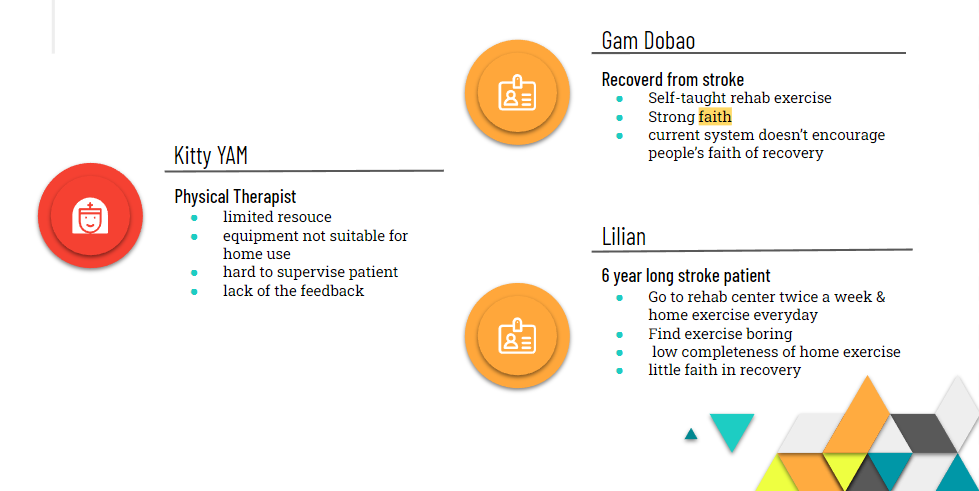
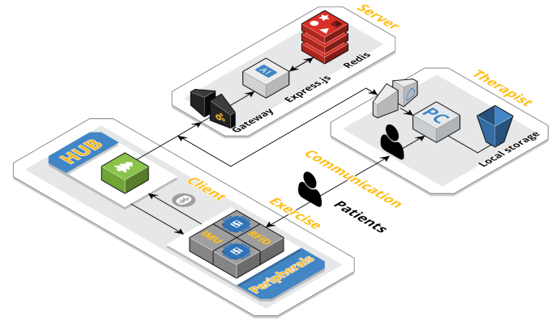
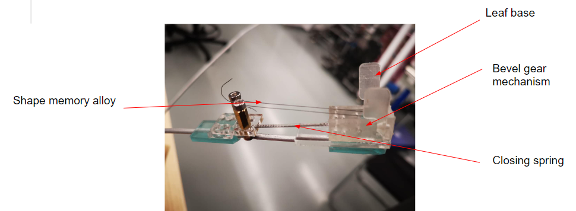

This is the 2019-2020 Year 2 project of ISD. This project worked with several Hong Kong elderly centers and rehab centers. The topic is scoped by the professor which is Elderly Robotics. After some interviews shadowing and observation with several elders and physical therapist, the team believes that the main obstacle lying in the way for elderly rehab is motivation. Therefore the team proposed a system that can motivate elders to do rehab activities and allow therapist to track there process more conveniently.



# **Empathize**

The team interviewed a physical therapist and her stroke patient Lilian and did a shadowing on recovered stroke patient Mr. Gam Dobao.

# **Problem Statement**

> Motivation plays a crucial role in effective therapy. However, stroke patients often lose motivation during rehabilitation, especially when they cannot see immediate progress or receive instant feedback during home exercises.
> 

# **Solution**

1. We aim to create a system that motivates elderly patients and makes home exercise accessible.
2. To ensure elderly-friendly design, we focus on tactile and physical interfaces.
3. We chose a potted plant as the main product since it's familiar in homes and symbolizes hope and growth.

The proposed system consists of a main device (a mechanical plant/pot hub), a backend server, and a therapist interface.

The hub features a mechanical tree that blooms with leaves as rehabilitation progresses, mimicking the nurturing of a real plant. Additional accessories support the elderly in their rehabilitation exercises.

# **Videos**

Here is the introduction video for the proposal

<iframe width="560" height="315" src="https://www.youtube.com/embed/mE0o_wpYyUY?si=xdW6gbCCxoeRSsvC" title="YouTube video player" frameborder="0" allow="accelerometer; autoplay; clipboard-write; encrypted-media; gyroscope; picture-in-picture; web-share" referrerpolicy="strict-origin-when-cross-origin" allowfullscreen></iframe>