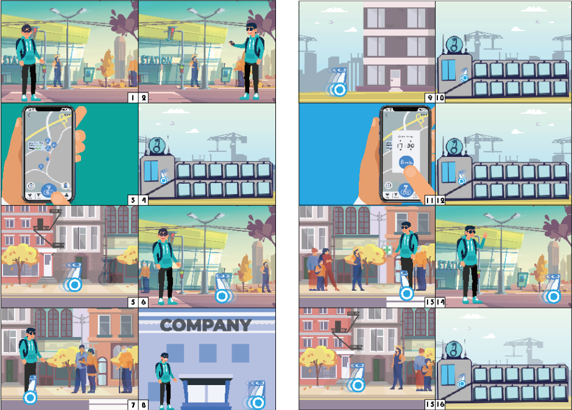

This is the 2020-2021 Year 3 first semester project of ISD. This project has no industrial partner due to the pandemic. The topic is scoped by the professor which is Personal Mobility. After some interviews and observation of current sharing transportation, the team thinks that the biggest problem of the current system is deployment. Sharing devices is hard to deploy. Therefore a self-driving sharing personal mobility system is proposed.



# **Empathize**

The three team members conducted separate problem formulation processes and interviews related to Personal Mobility Devices (PMD). During our interviews, we used the Abstract Ladder technique to uncover the interviewees' deeper needs. By repeatedly asking "why," we delved deeper into understanding their requirements while generating "How Might We" (HMW) questions based on their responses. Below are some of the Abstract Ladders we created during this process.

# **Problem Statement**

> How Might we enable people to spend their last mile's journey more conveniently
> 
> 
> How might we help user to store their personal mobility device?
> 

# **Solution**

The storyboard follows Jack, a commuter exiting a subway station who cannot find a shared bike. He uses his phone to request our product—a Personal Mobility Device (PMD). The PMD automatically leaves its charging station and navigates to Jack's location. Once it arrives, Jack hops on and rides to his destination. Upon arrival, Jack enters his building while the PMD autonomously returns to the nearest charging station, docks itself, and recharges while awaiting its next user. Later, when Jack plans to leave, he schedules the PMD to meet him downstairs. As Jack exits the building, he simply boards the waiting PMD and rides to the station. After Jack enters the station, the PMD returns to its charging station independently.

To implement our idea, we utilize the [Segway Loomo](https://www.segway.com/loomo/), an open platform for engineers and designers to create personal robots through robot applications and accessories. We enhance it with a miniPC running ROS and upgrade to a superior camera (Realsense D450). We also develop our own automatic charging mechanism and construct a dedicated charging station for the system.

[Check Report](/assets/images/projects/mobee/Mobee_Final_Report.pdf){: .btn .btn--info}
