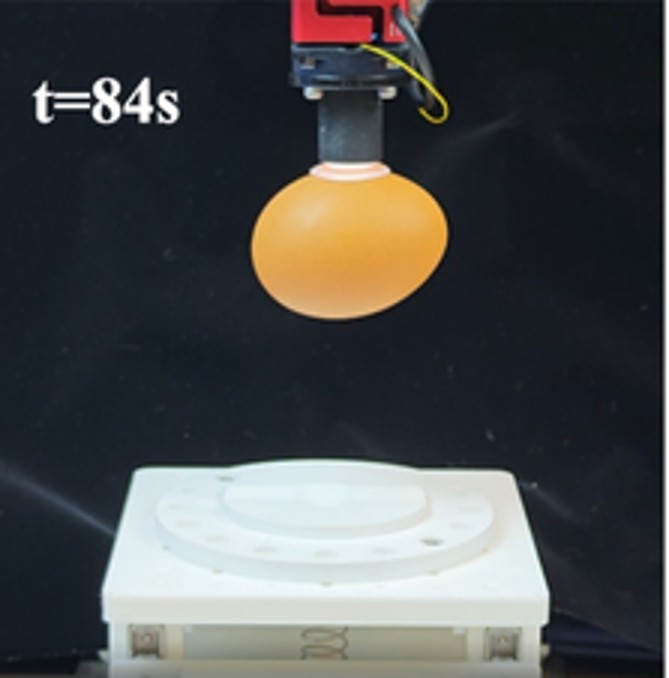
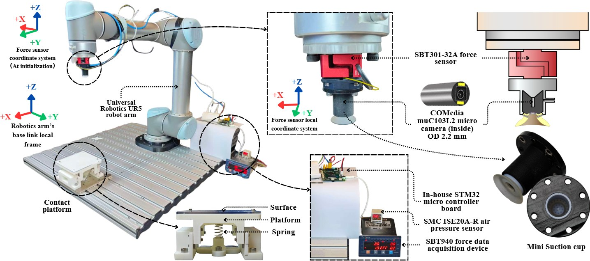
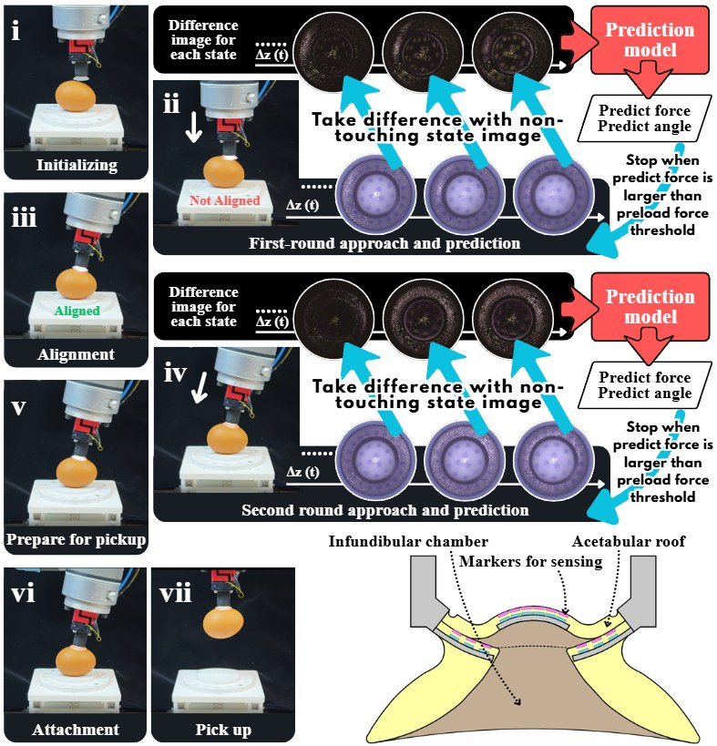
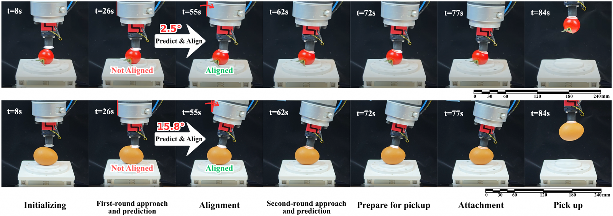

  <header class="sc-hero" id="sc-top">
    

      
Bio-inspired robotics · TMECH 2026

      
Small cup. Deep sense of touch.

      
Before a robot can lift something delicate, it needs to understand how it touches it.

      
Inspired by the octopus, our miniature suction cup uses a camera to sense contact — turning deformation into force and orientation estimates for closed-loop alignment.

      
<a class="sc-button" href="https://ieeexplore.ieee.org/document/11556293">Read the paper ↗</a><a class="sc-text-link" data-scroll-ignore href="#sc-loop">Follow the pickup ↓</a>

      
<strong>Yuchen Liang</strong> · First author Lai Yin Garmisch Wong · Yang Wei · Ming Chun Chan · Wenqi Hu · Rob B.N. Scharff

    

    <figure class="sc-hero-figure"><figcaption>A delicate lift, guided by touch. Detail from the egg pickup experiment.</figcaption></figure>
  </header>
  <nav class="sc-nav" aria-label="Research story"><a data-scroll-ignore href="#sc-challenge">01 Challenge</a><a data-scroll-ignore href="#sc-sense">02 Sensing</a><a data-scroll-ignore href="#sc-loop">03 Pickup</a><a data-scroll-ignore href="#sc-evidence">04 Evidence</a></nav>
  <section class="sc-section sc-intro" id="sc-challenge">
    
01 / The challenge

    <h2>Grasping starts before the lift.</h2>
    

Small, curved objects rarely meet a robot at the perfect angle.

A suction cup must establish contact and a seal. With delicate objects, simply pressing harder is not the answer. Contact orientation and pressing force provide the feedback needed to adjust the approach.

Our approach brings that sensing into a <strong>22 × 40 mm</strong> suction cup, rather than treating touch and attachment as separate functions.

    

<strong>22 × 40 mm</strong>Compact sensorized device

<strong>3 axes</strong>Pressing-force estimation

<strong>1 shared model</strong>Across same-design devices

  </section>
  <section class="sc-section" id="sc-sense">
    
02 / From deformation to information

    <h2>A camera that looks inward.</h2>
    

The cup’s deformation becomes its tactile signal.

A micro-camera observes the sensing markers inside the cup. Comparing contact images with the non-contact reference reveals changes that a prediction model uses to estimate three-axis pressing force and contact orientation.

<strong>Universally calibrated, not universally applicable.</strong> Devices with the same design can share a model without per-unit calibration. This does not imply transfer to arbitrary suction cups or every surface.

01<strong>Touch</strong>
The compliant cup deforms on contact.

02<strong>Observe</strong>
The internal camera captures the visual change.

03<strong>Estimate</strong>
A shared model predicts force, pitch and roll.

04<strong>Adjust</strong>
The robot corrects its contact orientation.

    

Look inside the experimental system
<figure><figcaption>Research setup and device construction. The reference force sensor is part of the experimental setup; the cup’s tactile estimates come from vision. Select the image to view it at full size.</figcaption></figure>

  </section>
  <section class="sc-section" id="sc-loop">
    
03 / Closing the loop

    <h2>Touch. Align. Attach. Lift.</h2>
    
Not a blind pickup: contact feedback informs the next movement.

    
<figure class="sc-sticky-figure"><figcaption>The research workflow links internal images to robot alignment. Select the figure to inspect its labels.</figcaption></figure><ol class="sc-steps"><li>01 / Approach<h3>Make contact, then listen.</h3>
The robot approaches the surface. Differences from the non-contact image supply the visual input for force and orientation prediction.
</li><li>02 / Align<h3>Correct the angle.</h3>
Estimated contact orientation guides robot realignment. The cup approaches again, using predicted pressing force to limit the contact preload.
</li><li>03 / Attach<h3>Establish the seal.</h3>
After alignment and preparation for pickup, the cup attaches to the object. Sensing and suction serve distinct roles: understanding contact, then securing the grasp.
</li><li>04 / Lift<h3>Carry something delicate.</h3>
Egg and tomato demonstrations show the process on curved, delicate objects. These examples illustrate the method, not a guarantee of success on every object.
</li></ol>

    

Explore the full tomato and egg sequences
<figure><figcaption>Top: tomato. Bottom: egg. Read left to right; these are experimental sequences, not a speed benchmark. Open the image for full-size labels.</figcaption></figure>

    
<iframe width="560" height="315" loading="lazy" src="https://www.youtube.com/embed/x3l9vSXl9gc" title="Miniature vision-based suction cup research demonstration" allow="accelerometer; autoplay; clipboard-write; encrypted-media; gyroscope; picture-in-picture; web-share" referrerpolicy="strict-origin-when-cross-origin" allowfullscreen></iframe>

Watch the experimental demonstration · <a href="https://www.youtube.com/watch?v=x3l9vSXl9gc">Open on YouTube ↗</a>

  </section>
  <section class="sc-section" id="sc-evidence">
    
04 / Quantitative evidence

    <h2>What does the cup measure?</h2>
    
Reported mean absolute errors (MAE). Orientation and force are different quantities — shown separately, in their own units.

    

<h3>Contact orientation</h3><dl>
<dt>Pitch</dt><dd>1.43° MAE</dd>

<dt>Roll</dt><dd>1.45° MAE</dd>
</dl>

<h3>Pressing force</h3><dl>
<dt>Fx</dt><dd>0.254N MAE</dd>

<dt>Fy</dt><dd>0.256N MAE</dd>

<dt>Fz</dt><dd>0.763N MAE</dd>
</dl>

    
Source: published IEEE abstract. These are estimation errors, not adhesion strength, maximum payload or grasp-success rates. See the paper for experimental conditions and evaluation protocol.

    

<h3>What is demonstrated</h3>
Compact vision-based tactile sensing; shared calibration across identically designed devices; closed-loop alignment and real-world handling of small, delicate, misaligned and curved objects.

<h3>What remains open</h3>
The reported demonstrations do not establish performance on every material, surface texture or geometry. Broader surface testing, long-term durability and transfer beyond the same device design are useful directions for future evaluation, not results claimed here.

  </section>
  <footer class="sc-paper">
The publication
<h2>Octopus-Inspired Embodied Tactile Intelligence: A Universally Calibrated Miniature Vision-Based Suction Cup</h2>
Yuchen Liang; Lai Yin Garmisch Wong; Yang Wei; Ming Chun Chan; Wenqi Hu; Rob B.N. Scharff

<em>IEEE/ASME Transactions on Mechatronics</em>, vol. 31, no. 4, pp. 4719–4727, August 2026. Published online June 9, 2026.

DOI: 10.1109/TMECH.2026.3694100

<a class="sc-button" href="https://doi.org/10.1109/TMECH.2026.3694100">Read the published paper ↗</a><a class="sc-text-link" href="/publications/2026-06-01-suctioncup-tmech/">Publication details →</a>

Earlier related work: <a href="/publications/2025-01-17-SRC/">Compact Octopus-Inspired Suction Cup with Optoelectronic Innervation for Soft Continuum Robot Arms</a> · SRC 2025
<a class="sc-text-link" data-scroll-ignore href="#sc-top">Back to the beginning ↑</a></footer>

